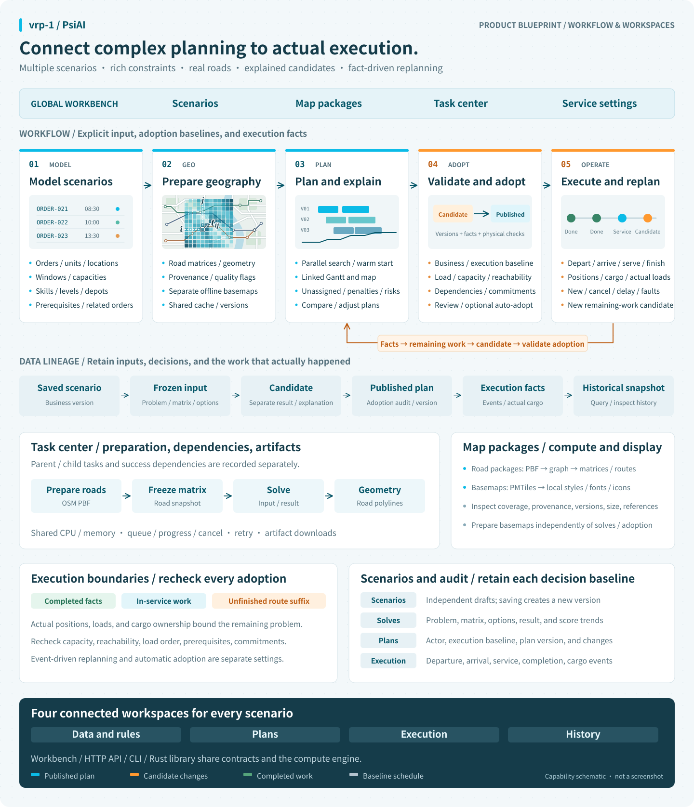
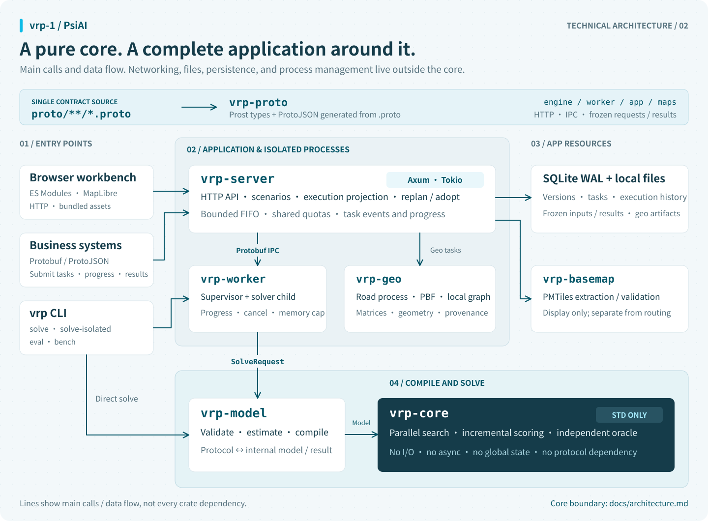
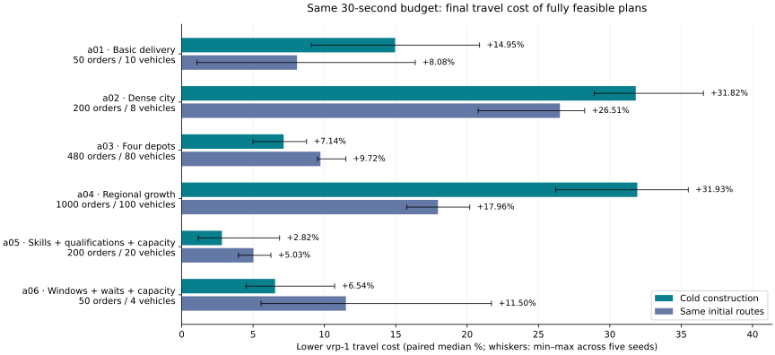
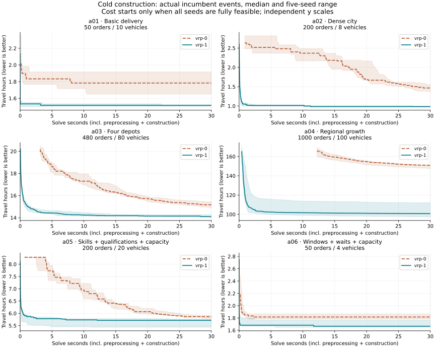
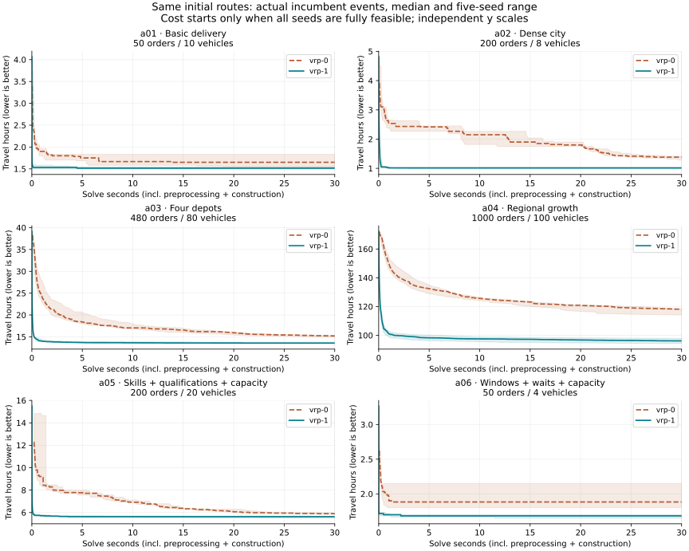
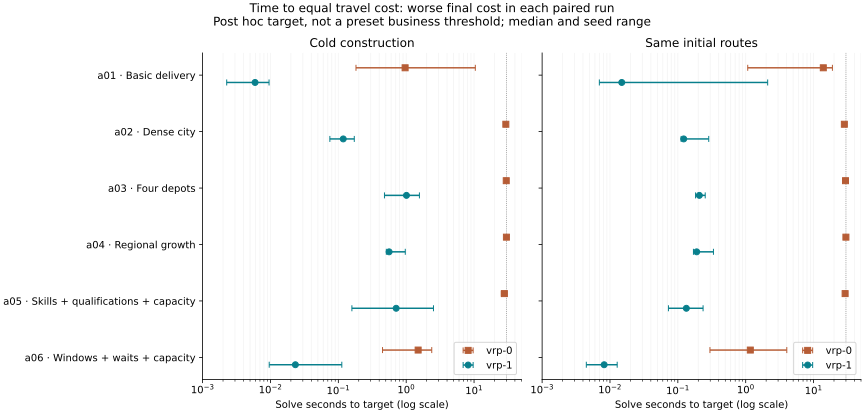
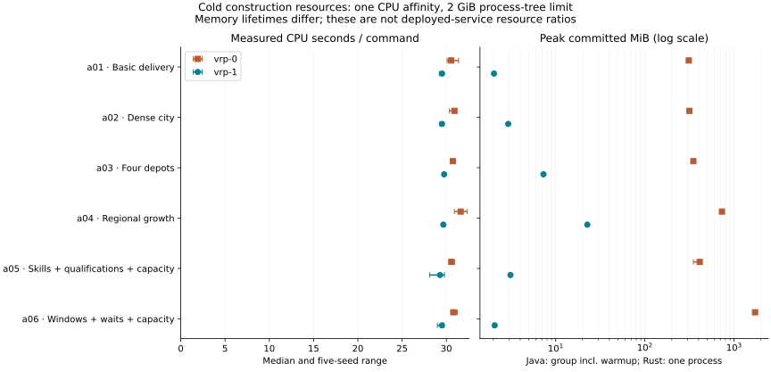

<p align="center">
  
</p>

<h1 align="center">vrp-1</h1>

<p align="center">
  <strong>Vehicle routing · Live dispatch · Explainable optimization</strong>
</p>

<p align="center">
  <a href="Cargo.toml"></a>
  <a href="proto/"></a>
  <a href="docs/server.md"></a>
  <a href="docs/maps-and-import.md"></a>
  <a href="crates/vrp-core/"></a>
</p>

<p align="center">
  <strong>English</strong> · <a href="README.zh-CN.md">简体中文</a>
</p>

<p align="center">
  <a href="#product-blueprint">Blueprint</a> ·
  <a href="#product-overview">Overview</a> ·
  <a href="#workbench-and-dispatch">Workbench</a> ·
  <a href="#deployment-and-quick-start">Quick start</a> ·
  <a href="#cli-and-api">CLI and API</a> ·
  <a href="#technology-and-architecture">Architecture</a> ·
  <a href="#reproducible-solver-evaluation">Evaluation</a> ·
  <a href="#development-and-verification">Development</a> ·
  <a href="#further-documentation">Documentation</a>
</p>

**vrp-1 is PsiAI's vehicle routing and dispatch engine.** It schedules delivery, pickup, and field service orders for vehicles and service teams under constraints such as time windows, capacity, skills, qualifications, and task dependencies. It supports both planning before departure and replanning remaining work as positions, completions, new orders, and breakdowns are reported.

Use the browser workbench to edit scenarios, inspect linked Gantt schedules and maps, compare candidates, and adopt a plan. Integrate through the CLI, HTTP API, or Rust library. The service, solver processes, and interface can run on one machine, with scenarios, tasks, and execution history stored in your own data directory.

## Product blueprint

Scenario modeling, geographic preparation, explained planning, validated adoption, and execution form a complete feedback loop. The blueprint expands task dependencies, map packages, adoption boundaries, four scenario workspaces, and version lineage. Saved scenarios, frozen inputs, candidates, published plans, and execution facts are retained separately.

[](docs/assets/readme/product-blueprint.en.svg)

## Product overview

| What you need | What vrp-1 provides |
| --- | --- |
| Schedule vehicles and service teams | Time windows, multidimensional capacity, skills, qualifications, depots, shifts, and multiple prerequisites |
| Understand a proposed plan | Linked Gantt and map views, unassigned orders, constraint penalties, travel statistics, and score trends |
| Improve an existing plan | Continue optimization or manually change assignments and visit order, creating a separate, reevaluated candidate |
| Handle changes after departure | Replan remaining orders using execution reports, new orders, cancellations, breakdowns, actual loads, and commitments |
| Prepare road networks and matrices | Select Geofabrik packages for the scenario, reuse local PBF files, and generate road matrices and route geometry |
| View maps without internet access | Automatically prepare native zoom levels 0–14, explicitly add level 15, or import PMTiles |
| Manage background computation | Track progress, dependencies, errors, and artifacts for solves, downloads, graph builds, matrices, and routes |
| Retain decisions and results | Persist scenario versions, frozen inputs, candidates, published plans, score trends, and execution snapshots |
| Integrate with existing systems | Protobuf / ProtoJSON HTTP API, an offline CLI, and a Rust compute core using only the standard library |

The design scope is **up to 1,000 business orders and 200 vehicles per problem**. Multiple independent tasks can run concurrently within a shared machine quota. Heuristic search returns the best plan found and explanations of its constraints.

## Workbench and dispatch

The workbench has four global entry points: Scenarios, Road packages, Task center, and Service settings. Each scenario keeps business data, planning candidates, and actual execution in separate workspaces.

| Workspace | Main actions |
| --- | --- |
| Data and rules | Edit orders, resources, locations, matrices, constraints, and costs; paste spreadsheet data, undo changes, and maintain prerequisites |
| Plans | Inspect Gantt schedules, maps, unassigned reasons, and score trends; compare candidates, reassign orders, or reorder visits |
| Execution | Adopt a plan; report departure, arrival, service, completion, and cargo handling; compare actual execution with replan candidates |
| History | Review scenario versions, execution events, and historical snapshots; download frozen task inputs and results |
| Road packages and Task center | Manage source packages, coverage, and versions; track matrix, solve, and geometry workflows; cancel or retry tasks |

The Gantt and map share selection state. They appear side by side on wide screens and stack on narrow screens. MapLibre is bundled with the application. Maps prefer offline packages: opening a saved scenario prepares a Protomaps v4 regional package in the background, using online OSM tiles while the package is unavailable. Chinese place-name fonts, icons, and styles are bundled. Once preparation finishes, external internet access is no longer required; the browser must still reach the local or LAN service. Custom tiles, styles, and PMTiles are also supported. A coordinate schematic is available without WebGL. Segments with road geometry follow roads; other segments use dashed visit-order lines.

Road package management includes separate road-network and basemap tabs. Automatic basemap preparation extracts native zoom levels 0–14 only; zooming the map does not trigger more downloads. Level 15 requires an estimate and confirmation through detailed basemap preparation, or an import. Basemaps do not affect matrices, solves, adoption, or execution reports. See [offline basemaps](docs/offline-basemaps.md) for coverage, quotas, and offline deployment.

Road matrices estimate travel time using a regular passenger-car speed model. Parts that cannot be calculated on the road network use explicit geometric estimates, with provenance retained in matrices and results. See [geographic tasks](docs/geo-tasks.md) for the relationship between road preparation, matrix generation, and solving.

### From planning to actual execution

1. Create or import a scenario. Prepare orders, resources, locations, and rules in Data and rules, then save a business version.
2. Generate a matrix and plan: prepare roads, freeze the matrix, solve, and generate road geometry.
3. Inspect schedules, unassigned orders, and constraint explanations in Plans. Continue optimization or make manual adjustments as needed.
4. Adopt the plan and enter Execution. Update vehicle, order, and cargo state through actual execution events.
5. Replan during execution when needed. Inspect candidate changes before adopting, or explicitly enable automatic adoption.

The three computation actions use different business baselines:

| Action | When to use it | Input baseline |
| --- | --- | --- |
| Continue optimization | The problem and execution baseline are unchanged; improve the existing result | The original job's frozen input and final solution |
| Plan again | Orders, resources, time windows, or rules have changed | A newly saved scenario version |
| Live replan | Execution has begun; adjust unfinished work | Current execution facts, actual loads, commitments, and the published plan |

Plans require human confirmation by default. Adoption rechecks completed and in-service facts, cargo ownership, and explicit commitments. Event-driven replanning and automatic adoption are configured separately. See the [workbench guide](docs/workbench.md) and [live execution rules](docs/realtime-planning.md).

## Deployment and quick start

Building from source requires a Rust toolchain supporting Edition 2024 and system build tools. Running the service requires no Node.js installation, separate SQLite server, or protoc. The browser interface and frontend libraries are bundled.

For a WorkBuddy prompt, the loopback MCP configuration, and a runnable local example, see the [agent local quick start (中文)](docs/agent-local-quickstart.md).

### First build from source

```bash
git clone https://github.com/Scisaga/vrp-1.git
cd vrp-1
cargo build --locked --release -p vrp-server -p vrp-cli
```

### Start an existing binary

Run from the project root. These commands configure **local-only access without a token**.

Windows PowerShell:

```powershell
.\target\release\vrp-server.exe --bind 127.0.0.1:8080 --data-dir var --cpu-multiplier 1.8
```

Linux:

```bash
./target/release/vrp-server --bind 127.0.0.1:8080 --data-dir var --cpu-multiplier 1.8
```

Open **[http://127.0.0.1:8080](http://127.0.0.1:8080)**. Create a scenario with the plus button at the top right of the scenario list, or use the adjacent import button to load native `.json` / `.pb` input. The repository and release packages do not include business scenarios.

**For daily use, run the existing binary directly; a rebuild is unnecessary.** A Windows packaging script is provided. Linux can be built natively; see the [deployment guide's verification scope](docs/server.md#当前验证范围).

### Reuse existing data

`--data-dir` selects the directory holding scenarios, tasks, execution history, and geographic artifacts. **Reuse the same directory after a restart. A new directory opens an empty workbench.** For example, use `--data-dir var/preview` if your data is in `var/preview`.

The default is `var/`. Relative paths resolve from the process's working directory. Only one service instance may use a data directory at a time. See [deployment, recovery, and capacity](docs/server.md) for backups and upgrades.

### Windows release package

From the source directory, build a ZIP containing the service, CLI, contracts, and documentation:

```powershell
powershell -File scripts/package-windows.ps1
```

Artifacts appear in `target/dist/`. Extract the archive and run `start.cmd`; data is stored in the extracted directory's `var/`. Continue using the original data directory when restarting an existing instance.

<details>
<summary>LAN access, compute quotas, and map configuration</summary>

| Setting | Purpose |
| --- | --- |
| `--bind 127.0.0.1:8080` | Local-only access; direct loopback access requires no token |
| `--data-dir <directory>` | Persistent data directory; keep it consistent across restarts |
| `--cpu-multiplier 1.8` | Shared thread quota: available logical CPUs multiplied by this value, rounded down, with a minimum of 1 |
| `--total-threads <count>` | Set the shared thread quota directly; overrides the CPU multiplier |
| `--geo-local-dir <directory>` | Register existing server-side PBF files for road preparation |
| `--basemap-auto false` | Disable automatic preparation when a map first opens; retain manual preparation and imports |
| `--basemap-download-mib 500` | Budget for newly transferred basemap data per preparation |
| `--basemap-storage-mib 10240` | Separate basemap disk quota, including temporary peak usage |
| `--map-config <file>` | Configure custom MapLibre styles, tiles, or PMTiles |

For access from other devices, bind to a non-loopback address and set `VRP_API_TOKEN` to at least 16 visible ASCII characters. **Direct local access through a loopback address such as `127.0.0.1` needs no token; non-loopback access requires one.** The service checks both the real connection source and Host; forwarded requests remain authenticated. Enter the token through Access settings in the workbench. It is held only in the current page's memory.

Concurrency is also bounded by process and memory budgets. See the [service guide](docs/server.md) for all parameters and access settings, and [map configuration](docs/maps-and-import.md#底图配置) for basemaps.

</details>

## CLI and API

### Offline solving and benchmarks

The first build produces `vrp-server` and `vrp`. These examples use Windows PowerShell; on Linux, replace `.\target\release\vrp.exe` with `./target/release/vrp`. Supply your own input and use a new output path.

```powershell
# Regular solve: the 30-second preset, four search threads
.\target\release\vrp.exe solve corpus/request.pb corpus/result.pb --preset fast --threads 4

# Isolated solve: alpha-kopt search, 1024 MiB child-process memory limit
.\target\release\vrp.exe solve-isolated corpus/request.pb corpus/result-isolated.pb --search alpha-kopt --threads 2 --memory-mib 1024

# Benchmark the private corpus from the project root
.\target\release\vrp.exe bench --corpus corpus
```

| Preset | Default stop condition |
| --- | --- |
| `fast` | 30-second total solve limit; the default preset |
| `standard` | 120-second total solve limit |
| `deep` | Stop after 300 consecutive seconds without a better global best score; no total solve limit by default |

Override limits with `--time-limit-ms` and `--unimproved-ms`; set search threads with `--threads`. Road preparation and queueing are outside the solve time limit. All tasks share the deployment's quota. The default search strategy is `nearest`; `baseline`, `alpha`, and `alpha-kopt` are also available. See [search implementation](docs/search.md) for algorithm sources and implementation boundaries.

Use `eval` to rescore a solution and inspect constraints. `import-v1` and `export-scene` convert historical inputs. `vrp-import-v1` is for benchmarks and historical replay only. See the [corpus guide](docs/corpus.md) and [scenario import guide](docs/maps-and-import.md).

### HTTP API

The HTTP API accepts Protobuf or ProtoJSON for integration with business systems. Files under [`proto/`](proto/) are the authority for every message and endpoint.

| Endpoint | Purpose |
| --- | --- |
| `/v1/scenarios` | Save, query, and import scenario versions |
| `/v1/scenarios/{id}/geo-plan` | Prepare matrices, solve, and generate routes for a scenario |
| `/v1/tasks` | Query and manage solve, road, matrix, and route tasks |
| `/v1/jobs/{id}/request`, `/result` | Download frozen requests and results |
| `/v1/operations` | Start execution, report events, replan, adopt, and query history |
| `/healthz` | Inspect thread quota, running and queued counts, and service health |

See the [service API guide](docs/server.md) for complete requests, pagination, idempotency, event streams, and error handling.

## Technology and architecture

| Layer | Technology | Responsibility |
| --- | --- | --- |
| Workbench | Native ES Modules · HTML / CSS · MapLibre · PMTiles | Scenario editing, Gantt, maps, tasks, and execution views |
| Standalone service | Rust · Axum · Tokio · SQLite WAL | HTTP API, scenario versions, durable tasks, execution projection, and adoption |
| Road service | Rust · OSM PBF | Package selection and reuse, local graph construction, matrices, and road geometry |
| Offline basemaps | Rust · PMTiles · bundled fonts and icons | Regional extraction and validation, hosted offline display resources; separate from road computation |
| Isolated worker | Child processes · Protobuf IPC · OS resource limits | Shared compute quotas, progress, cancellation, and process cleanup |
| Model and contracts | `.proto` · Prost · ProtoJSON | Type generation, validation, missing-edge estimates, and request / result conversion |
| Compute core | Rust standard library · incremental scoring · parallel search | Constraint evaluation, candidate exploration, and independent full-score explanations |

[](docs/assets/readme/architecture.en.svg)

`vrp-core` depends only on the Rust standard library. It performs no I/O, uses no async, and holds no global state. Road downloads, file processing, persistence, and the interface belong to outer components. Scores are compared in Hard / Medium / Soft order. Search uses incremental scoring; an independent full scorer verifies the final result and generates explanations. See the [architecture](docs/architecture.md) for component boundaries and [constraints v2](docs/constraints-v2.md) for scoring semantics.

<!-- solver-evaluation:start -->
## Reproducible solver evaluation

The comparison project, [vrp-0](https://github.com/Scisaga/vrp-0), is another open-source planning engine by the author of vrp-1, implemented in Java with OptaPlanner. The results below apply to the source revision, dependencies and configuration pinned in the report.

The first round measured **12 synthetic scenarios, 5 seeds, 30 seconds and 1 solver thread per run**, serially on Windows / Ryzen AI 7 PRO 350 with one CPU affinity and a 2 GiB process-tree limit. vrp-0 `8cc39f6` uses OptaPlanner `999-20240618-SNAPSHOT` / JDK 21; vrp-1 uses base `eb6333f` plus the [recorded evaluation build](docs/benchmarks/round-1/report.md). Java receives three 20-second warmups per group; its last warmup still shows JIT activity, so fully compiled steady-state convergence has not been established.

**150 timed runs: 120 shared-objective solves and 30 native capability checks.** All 120/120 shared outputs were fully assigned, hard=0 and independently validated. Paired vrp-1 **win/tie/loss: 60/0/0**, with 0 noncomparable pairs. The score gate checked 80 samples (64 distinct mappings) and 12 full-problem initial plans before timing.

**Final quality under the same budget.** Percentages are medians of paired reductions in total travel seconds; positive values favor this vrp-1 configuration. Whiskers show the minimum–maximum seed range. Cold construction and continuation from identical initial routes are separate experiments.



| Shared scenario (orders / vehicles) | Cold travel reduction | Continuation reduction | First full feasible: vrp-0 (ms) | vrp-1 (ms) |
|---|---:|---:|---:|---:|
| Basic delivery (50 / 10) | +14.95% (5/5) | +8.08% (5/5) | 69.0 | 0.7 |
| Dense / long routes (200 / 8) | +31.82% (5/5) | +26.51% (5/5) | 665.1 | 11.1 |
| Regional / four depots (480 / 80) | +7.14% (5/5) | +9.72% (5/5) | 2654.1 | 35.6 |
| Scale / heterogeneous limits (1000 / 100) | +31.93% (5/5) | +17.96% (5/5) | 11491.1 | 240.5 |
| Skills / qualifications / capacity (200 / 20) | +2.82% (5/5) | +5.03% (5/5) | 543.1 | 7.3 |
| Tight windows / waits / capacity (50 / 4) | +6.54% (5/5) | +11.50% (5/5) | 57.0 | 0.8 |

Parentheses give eligible pairs, requiring both outputs fully feasible. First-full times are cold-construction medians: full assignment and zero hard violations, which is a different threshold from equal travel cost.

**Actual solve curves: cold construction.**



**Actual solve curves: continuation from identical routes.**



Lines are medians of actual best-solution events; shading is the five-seed range. Cost is shown only after **all five seeds** are fully assigned with zero hard violations. Gaps remain missing, with no interpolation before the first feasible incumbent. Each panel has its own y scale; lower total travel hours is better. Search time includes candidate preprocessing and initial construction. [Full curves including unassigned counts](docs/benchmarks/round-1/report.md#quality-versus-time).

**Time to equal business quality.**



For each scenario, start mode and seed, the target is the **worse of the two final fully feasible travel costs**. The figure shows the first actual time each solver reaches that target, on a logarithmic time axis. This is a post hoc paired target, not a preregistered industry quality threshold or a universal speedup factor. Missing hits remain censored; the [full report](docs/benchmarks/round-1/report.md#equal-quality-and-limitations) also retains the stricter, better-final-cost target.

**CPU, memory and stability.**

| Runtime | CPU seconds / command | Peak committed MiB | Memory lifetime |
|---|---:|---:|---|
| vrp-0 / prewarmed JVM | 30.2–31.6 | 310.5–1719.4 | Group, including warmup and earlier seeds |
| vrp-1 | 29.2–29.8 | 2.0–22.6 | One adapter process |

Ranges span per-instance medians across both start modes; the figure below shows cold construction with seed ranges. CPU includes each measured command; Rust includes native result explanation, while Java startup/warmup is separate. Memory lifetimes differ; the logarithmic memory axis keeps both visible and does not establish a deployed-service memory ratio. Sampled RSS, exact wall times, cold startup and JIT activity remain in the full report.



All **150/150 timed runs** in this public round succeeded; maximum observed search-budget overrun was **45.7 ms**. Unsupported legacy capability records (30) remain explicit and are excluded from algorithm rankings.

**Native capability acceptance: 30/30.** These synthetic frozen execution projections use v2 semantics and are evaluated separately from shared algorithm quality.

| Capability | Passed / runs | Median unassigned |
|---|---:|---:|
| Pickup / two capacity dimensions | 5/5 | 0 |
| Precedence / windows / shifts | 5/5 | 0 |
| Insert during execution | 5/5 | 0 |
| Cancel loaded delivery | 5/5 | 0 |
| Vehicle fault / completed work / locks | 5/5 | 9 |
| Insufficient resources / conflicts / unreachable | 5/5 | 46 |

Fault acceptance explicitly keeps blocked cargo unassigned; the infeasible case tests truthful partial service, so neither row claims full assignment. These are frozen projections, not real field-event replays. Private historical migration results and diagnostics remain in `corpus/` and are excluded from all public totals.

See the [method and reproduction commands](docs/evaluation.md), [complete report](docs/benchmarks/round-1/report.md), [published incumbent events](docs/benchmarks/round-1/traces.json), and [figure source fingerprints](docs/benchmarks/round-1/readme-figures.json). Conclusions apply to these versions, objectives, scenarios and budgets; they do not establish a general result about the OptaPlanner framework or production workloads.
<!-- solver-evaluation:end -->

## Development and verification

Run workspace checks from the project root:

```powershell
cargo test --workspace
cargo clippy --workspace --all-targets -- -D warnings
```

Browser acceptance checks additionally require Python, Playwright, and Chromium. Build the development server, then run the synthetic-scenario checks:

```powershell
cargo build -p vrp-server
python scripts/smoke_workbench.py
python scripts/smoke_geo_workbench.py
```

These scripts launch isolated services with synthetic scenarios. Geographic checks use a local synthetic catalog and PBF. Python and Playwright are development tools and are not required to run the service. See the corresponding design documents for coverage of differential scoring, execution state, task recovery, and geographic workflows.

<details>
<summary>Update README diagrams</summary>

The diagram generator uses the Python standard library and shares one layout between Chinese and English.

```powershell
python scripts/render_readme_diagrams.py
```

</details>

## Further documentation

This README and both SVG diagrams are available in English. The detailed documents below are currently in Chinese.

| Document | Contents |
| --- | --- |
| [Workbench](docs/workbench.md) | Workspace navigation, scenario editing, candidates, adoption, and execution |
| [Deployment and service API](docs/server.md) | Startup options, access settings, endpoints, capacity, recovery, and verification scope |
| [Live planning](docs/realtime-planning.md) | Execution facts, actual cargo, commitments, event-driven replanning, and adoption checks |
| [Geographic tasks](docs/geo-tasks.md) | Road packages, matrix admission, route generation, scheduling, and recovery |
| [Maps and scenario import](docs/maps-and-import.md) | Historical conversion, coordinates, custom basemaps, and external road geometry |
| [Offline basemaps](docs/offline-basemaps.md) | Regional extraction, display resources, zoom levels, quotas, and offline deployment |
| [Architecture](docs/architecture.md) | Modules, data flow, and compute boundaries |
| [Constraints v2](docs/constraints-v2.md) | Weights, time, capacity, dependencies, and execution consistency |
| [Worker](docs/worker.md) | Process isolation, resource quotas, IPC, and cancellation |
| [Search implementation](docs/search.md) / [Search roadmap](docs/search-roadmap.md) | Implemented algorithms, source papers, and operators under consideration |
| [Historical corpus](docs/corpus.md) | Private inputs, benchmarks, replay, and score verification |
| [Combinatorial search landscape](docs/combinatorial-search-landscape.md) | NP-hard / PSPACE problems and heuristics for other domains |

Business corpora, exports, and related reports belong in the Git-ignored `corpus/` directory; only `.gitkeep` is committed there.

## License

The vrp-1 source code is available under the Apache License, Version 2.0. [License text](LICENSE)

Bundled frontend and map assets carry their respective third-party notices. [MapLibre](web/vendor/maplibre-LICENSE.txt), [PMTiles](web/vendor/pmtiles-LICENSE.txt), and [offline map assets](web/vendor/basemap/NOTICE.md).
