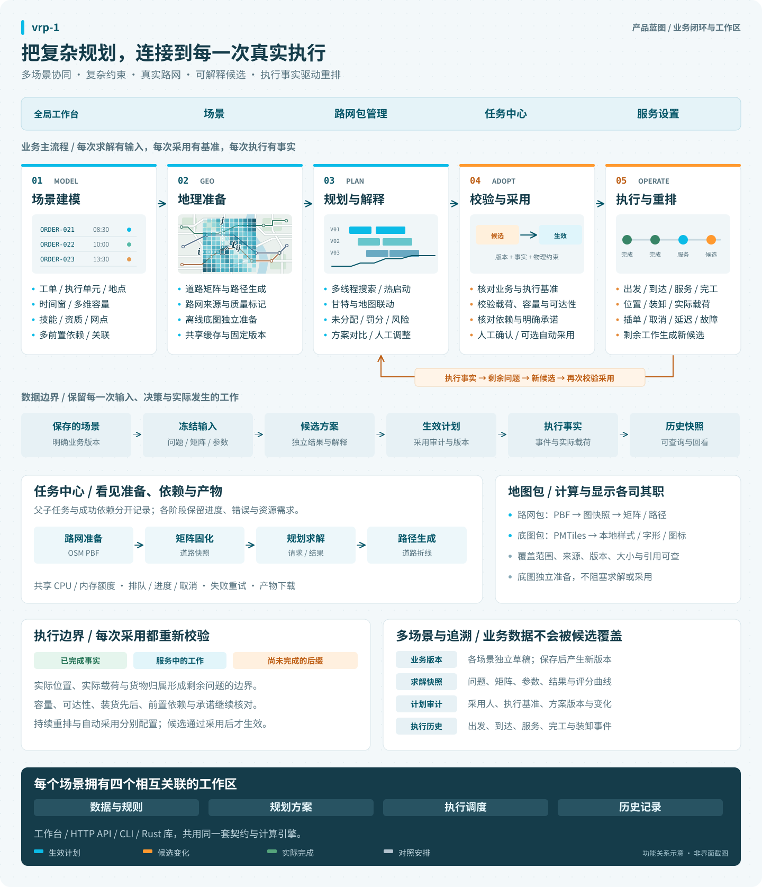
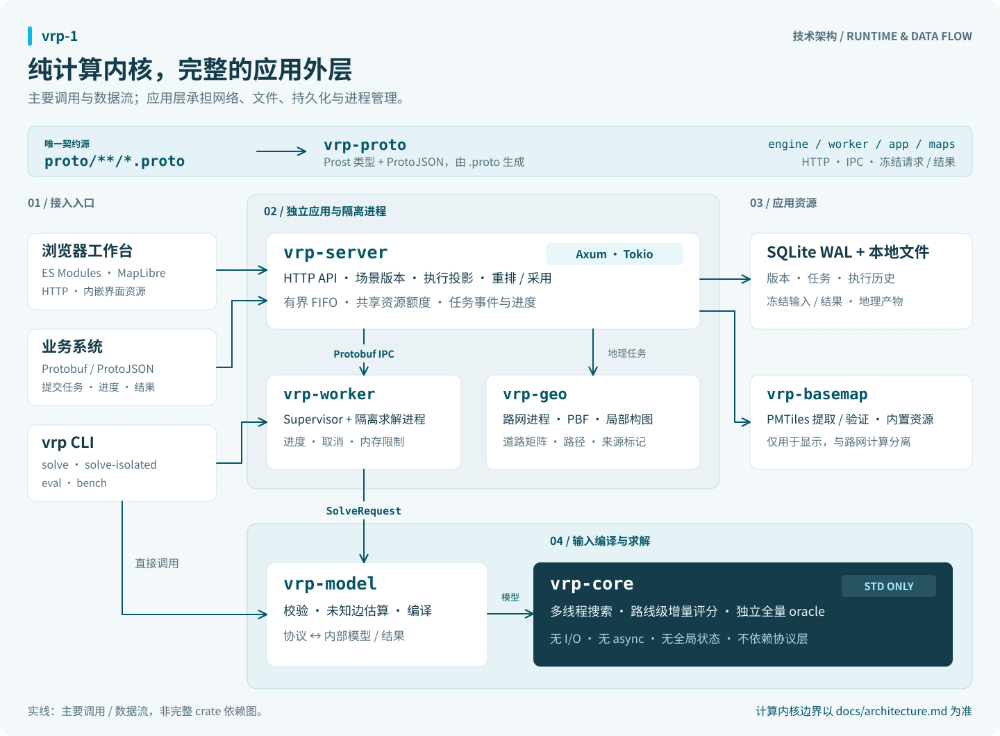
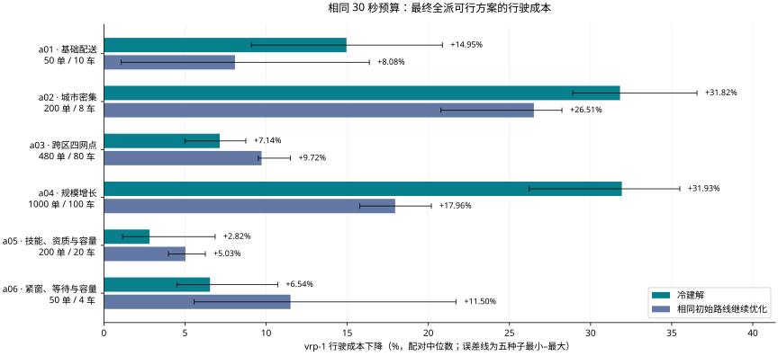
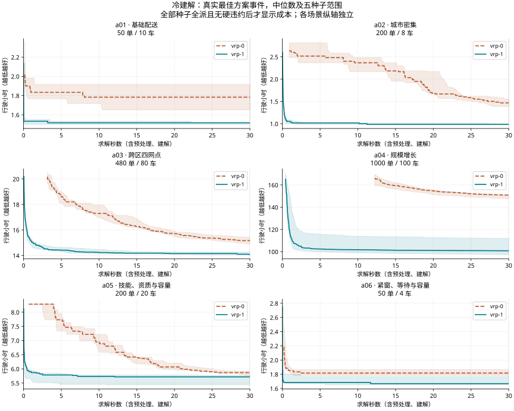
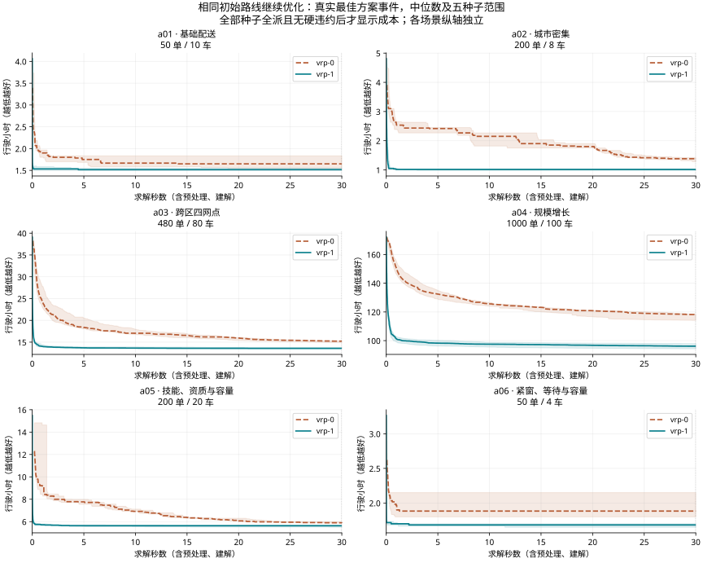
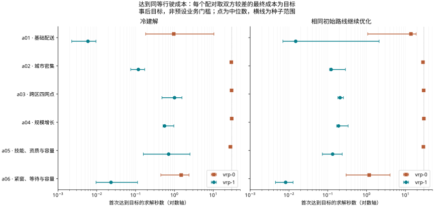
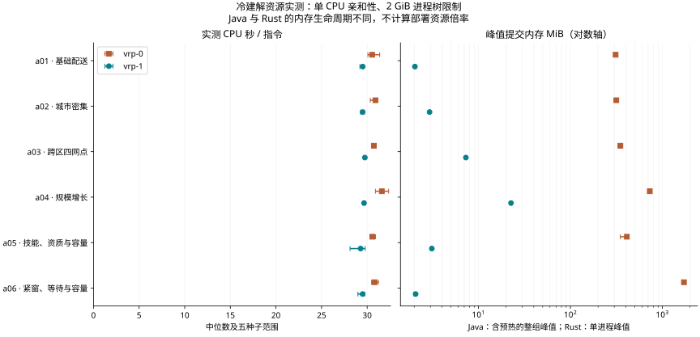

<p align="center">
  
</p>

<h1 align="center">vrp-1</h1>

<p align="center">
  <strong>车辆路径规划 · 现场执行调度 · 可解释的优化引擎</strong>
</p>

<p align="center">
  <a href="Cargo.toml"></a>
  <a href="proto/"></a>
  <a href="docs/server.md"></a>
  <a href="docs/maps-and-import.md"></a>
  <a href="crates/vrp-core/"></a>
</p>

<p align="center">
  <a href="README.md">English</a> · <strong>简体中文</strong>
</p>

<p align="center">
  <a href="#产品蓝图">产品蓝图</a> ·
  <a href="#产品概览">产品概览</a> ·
  <a href="#工作台与调度">工作台与调度</a> ·
  <a href="#部署与快速开始">快速开始</a> ·
  <a href="#命令行与接口">命令行与接口</a> ·
  <a href="#技术栈与架构">技术栈</a> ·
  <a href="#可复现求解评测">评测</a> ·
  <a href="#开发与验证">开发与验证</a> ·
  <a href="#更多文档">更多文档</a>
</p>

**vrp-1 是 PsiAI 的车辆路径规划与执行调度引擎。** 在时间窗、容量、技能、资质和前置依赖等约束下，为车辆与服务人员安排配送、取件和现场服务工单。既支持出发前生成方案，也支持车辆出发后根据实际位置、完工、插单和故障调整剩余任务。

通过浏览器工作台编辑场景、查看甘特排程与地图、比较候选并确认采用；也可以通过命令行、HTTP API 或 Rust 库接入业务系统。服务、求解进程和界面可在同一台机器运行，场景、任务与执行历史保存在自己的数据目录中。

## 产品蓝图

从场景建模、地理准备、规划解释、校验采用到执行重排，形成完整业务闭环。下图展开任务依赖、地图包、采用边界、四个场景工作区及版本追溯；保存的场景、冻结输入、候选、生效计划与实际执行各自保留。

[](docs/assets/readme/product-blueprint.zh-CN.svg)

## 产品概览

| 你想做什么 | vrp-1 提供什么 |
| --- | --- |
| 为车辆和服务人员安排工单 | 时间窗、多维容量、技能、资质、网点、班次与多前置依赖约束 |
| 看清方案是否合适 | 甘特排程与地图联动，展示未分配工单、约束罚分、行驶统计和求解曲线 |
| 改善已有方案 | 从已有结果继续优化，或人工调整指派与访问顺序，生成独立候选并重新评分 |
| 处理出发后的业务变化 | 接收执行回报、插单、取消和故障，结合实际载荷与承诺锁重排剩余工单 |
| 自行准备路网与矩阵 | 按场景范围选择 Geofabrik 路网包，复用本地 PBF，生成道路矩阵与路径 |
| 断网查看地图 | 按场景自动准备原生 0–14 级离线底图，手动补充 15 级，支持导入 PMTiles |
| 管理后台计算 | 统一查看求解、下载、构图、矩阵和路径任务的进度、依赖、错误与产物 |
| 保留过程与结果 | 场景版本、冻结输入、候选方案、生效计划、评分曲线和执行快照持久化 |
| 接入现有业务系统 | Protobuf / ProtoJSON HTTP API、离线 CLI，以及仅依赖标准库的 Rust 计算内核 |

单次问题面向 **不超过 1000 个业务工单、200 辆车**，支持多个独立任务共享机器额度并发运行。求解采用启发式搜索，返回已找到的最佳方案及约束解释。

## 工作台与调度

工作台提供“场景、路网包管理、任务中心、服务设置”四个全局入口。每个场景分别管理业务数据、规划候选与实际执行。

| 工作区 | 主要操作 |
| --- | --- |
| 数据与规则 | 编辑工单、执行单元、地点、矩阵、约束与费用；支持表格粘贴、撤销和前置工单维护 |
| 规划方案 | 查看甘特、地图、未分配原因和评分曲线，比较方案，人工改派或调整访问顺序 |
| 执行调度 | 采用计划，回报出发、到达、服务、完工及装卸，查看实际执行与重排候选的差异 |
| 历史记录 | 回看场景版本、执行事件与历史快照，下载任务的冻结输入和结果 |
| 路网包管理与任务中心 | 管理源包、覆盖范围和版本，跟踪矩阵、求解与路径生成流程，取消或重试任务 |

甘特与地图共享选中对象，宽屏并排、窄屏纵向排列。地图内嵌 MapLibre，默认离线优先：首次打开已保存场景时后台准备 Protomaps v4 区域包，缺包期间以在线 OSM 底图过渡。中文地名、图标和样式随程序提供，准备完成后可断开外网使用；浏览器仍须连接本机或局域网服务。也可配置自有瓦片、样式与 PMTiles；没有 WebGL 时使用坐标示意图。有道路数据的路段显示道路路径，缺少路径的路段显示访问顺序虚线。

“路网包管理”中提供路网包与底图包两个页签。自动准备只提取原生 0–14 级，地图放大不会追加下载；15 级通过“准备详细底图”预估并确认，或通过导入获得。底图不影响矩阵、求解、方案采用或执行回报。范围、额度和离线部署见[离线底图说明](docs/offline-basemaps.md)。

路网矩阵使用普通汽车速度模型估算行驶时间；无法通过路网计算的部分以显式几何估算补齐，来源标记保留在矩阵和结果中。路网准备、矩阵生成和求解的具体关系见[路网与通用任务](docs/geo-tasks.md)。

### 从规划到实际执行

1. 新建或导入场景，在“数据与规则”中准备工单、执行单元、地点和规则，并保存业务版本。
2. 选择“生成矩阵并规划”，依次准备路网、固化矩阵、求解并生成道路路径。
3. 在“规划方案”中检查排程、未分配工单与约束解释，需要时继续优化或人工调整。
4. 确认方案后“采用并进入执行”，通过实际事件更新车辆、工单和货物状态。
5. 执行过程中按需重排，检查候选变化后采用；也可显式开启自动采用。

三种计算操作分别对应不同业务状态：

| 操作 | 什么时候使用 | 输入基准 |
| --- | --- | --- |
| 继续优化 | 问题与执行基准未变，希望改善已有结果 | 原任务冻结输入和最终方案 |
| 重新规划 | 工单、执行单元、时间窗或规则已修改 | 新保存的场景版本 |
| 实时重排 | 已开始执行，需要调整尚未完成的工作 | 当前执行事实、实际载荷、承诺与生效计划 |

方案默认需要人工确认后生效。已完成和服务中的事实、货物归属与显式承诺在采用时继续校验；持续重排和自动采用分别配置。完整操作规则见[工作台说明](docs/workbench.md)与[实时执行规则](docs/realtime-planning.md)。

## 部署与快速开始

源码构建需要支持 Rust 2024 Edition 的工具链及系统编译工具。服务运行时无需安装 Node.js、SQLite 服务或 protoc；浏览器界面和前端库随程序提供。

### 首次从源码构建

```bash
git clone https://github.com/Scisaga/vrp-1.git
cd vrp-1
cargo build --locked --release -p vrp-server -p vrp-cli
```

### 启动已有程序

在项目根目录执行。以下命令使用**仅本机访问、无需 token**的配置。

Windows PowerShell：

```powershell
.\target\release\vrp-server.exe --bind 127.0.0.1:8080 --data-dir var --cpu-multiplier 1.8
```

Linux：

```bash
./target/release/vrp-server --bind 127.0.0.1:8080 --data-dir var --cpu-multiplier 1.8
```

打开 **[http://127.0.0.1:8080](http://127.0.0.1:8080)**，点击场景列表右上角的加号新建场景，或用旁边的导入图标读取原生 `.json` / `.pb` 输入。仓库和发行包不附带业务场景。

**日常启动直接运行已有程序，无需重新构建。** Windows 提供发行包脚本；Linux 可原生编译，具体平台验证范围见[部署说明](docs/server.md#当前验证范围)。

### 使用已有数据

`--data-dir` 指定场景、任务、执行历史和路网产物所在目录。**重启时沿用同一个目录；指定新目录会打开空工作台。** 例如原数据在 `var/preview`，启动时使用 `--data-dir var/preview`。

默认目录为 `var/`，相对路径以启动时的工作目录为准。每个数据目录只允许一个服务实例使用。备份与升级操作见[部署、恢复与容量说明](docs/server.md)。

### Windows 发行包

在源码目录执行以下命令，构建并生成包含服务、CLI、协议和文档的 ZIP：

```powershell
powershell -File scripts/package-windows.ps1
```

产物位于 `target/dist/`。解压后运行 `start.cmd`，数据保存在解压目录的 `var/`。已有实例重启时继续使用原数据目录。

<details>
<summary>局域网访问、计算额度与地图配置</summary>

| 配置 | 用途 |
| --- | --- |
| `--bind 127.0.0.1:8080` | 仅本机访问；直接通过回环地址访问无需填写令牌 |
| `--data-dir <目录>` | 指定持久化数据目录，重启时保持一致 |
| `--cpu-multiplier 1.8` | 总线程额度为可用逻辑 CPU 数乘以倍数后向下取整，最少为 1 |
| `--total-threads <数量>` | 直接指定全部任务共享的线程额度，优先于 CPU 倍数 |
| `--geo-local-dir <目录>` | 登记服务端已有 PBF，供路网准备复用 |
| `--basemap-auto false` | 关闭首次打开地图时的自动准备，保留手动准备与导入 |
| `--basemap-download-mib 500` | 单次新增底图传输预算 |
| `--basemap-storage-mib 10240` | 底图独立磁盘额度，含临时峰值 |
| `--map-config <文件>` | 使用自有 MapLibre 样式、瓦片或 PMTiles 配置 |

需要其他设备访问时，改为监听非回环地址，并设置至少 16 个可见 ASCII 字符的 `VRP_API_TOKEN`。**本机直接访问 `127.0.0.1` 等回环地址免 token，非回环地址访问需要 token。** 服务同时核对真实连接来源和 Host，转发请求继续鉴权。工作台通过“访问设置”填写令牌，仅保存在当前页面内存中。

任务并发还受运行进程数和内存预算限制。完整参数与访问配置见[服务说明](docs/server.md)，底图配置见[地图与路径说明](docs/maps-and-import.md#底图配置)。

</details>

## 命令行与接口

### 离线求解与基准

首次构建会生成 `vrp-server` 和 `vrp` 两个程序。下面为 Windows PowerShell 示例；Linux 将 `.\target\release\vrp.exe` 换为 `./target/release/vrp`。将输入文件替换为自己的请求，结果使用新的文件路径。

```powershell
# 普通求解：30 秒档，4 个搜索线程
.\target\release\vrp.exe solve corpus/request.pb corpus/result.pb --preset fast --threads 4

# 隔离进程求解：alpha-kopt 搜索，子进程内存上限 1024 MiB
.\target\release\vrp.exe solve-isolated corpus/request.pb corpus/result-isolated.pb --search alpha-kopt --threads 2 --memory-mib 1024

# 从项目根目录运行私有语料基准
.\target\release\vrp.exe bench --corpus corpus
```

| 档位 | 默认停止条件 |
| --- | --- |
| `fast` | 总求解时限 30 秒，默认档 |
| `standard` | 总求解时限 120 秒 |
| `deep` | 连续 300 秒没有全局最佳分数改善，总求解时限默认不限 |

可用 `--time-limit-ms`、`--unimproved-ms` 覆盖时限，用 `--threads` 设置搜索线程数。路网准备与排队不计入求解时限，所有任务共享部署额度。默认搜索策略为 `nearest`，可选 `baseline`、`alpha` 和 `alpha-kopt`；实现范围与算法来源见[搜索说明](docs/search.md)。

`eval` 用于重新评分和查看约束明细；`import-v1`、`export-scene` 用于历史输入转换。`vrp-import-v1` 只用于基准与历史回放。用法及语料组织见[历史语料说明](docs/corpus.md)和[场景导入说明](docs/maps-and-import.md)。

### HTTP API

HTTP API 接受 Protobuf 或 ProtoJSON，可直接接入业务系统。全部消息和接口路径以 [`proto/`](proto/) 下的 `.proto` 为准。

| 入口 | 用途 |
| --- | --- |
| `/v1/scenarios` | 保存、查询和导入场景版本 |
| `/v1/scenarios/{id}/geo-plan` | 按场景准备矩阵、求解并生成路径 |
| `/v1/tasks` | 查询与管理求解、路网、矩阵和路径任务 |
| `/v1/jobs/{id}/request`、`/result` | 下载冻结请求与求解结果 |
| `/v1/operations` | 开始执行、上报事件、重排、采用与历史查询 |
| `/healthz` | 查看线程额度、运行数、排队数及服务状态 |

完整请求示例、分页、幂等、事件流和错误处理见[服务 API](docs/server.md)。

## 技术栈与架构

| 层 | 技术 | 职责 |
| --- | --- | --- |
| 工作台 | 原生 ES Modules · HTML / CSS · MapLibre · PMTiles | 场景编辑、甘特、地图、任务与执行界面 |
| 独立服务 | Rust · Axum · Tokio · SQLite WAL | HTTP API、场景版本、持久任务、执行投影与采用 |
| 路网服务 | Rust · OSM PBF | 路网包选择与复用、局部构图、矩阵和道路路径生成 |
| 离线底图 | Rust · PMTiles · 内置字形与图标 | 区域底图提取与验证、离线显示资源托管，与路网计算分离 |
| 隔离 Worker | 子进程 · Protobuf IPC · 系统资源限制 | 共享计算额度、进度、取消与进程回收 |
| 模型与协议 | `.proto` · Prost · ProtoJSON | 类型生成、输入校验、估算补齐与请求／结果转换 |
| 计算核心 | Rust 标准库 · 增量评分 · 多线程搜索 | 约束评价、候选探索及独立全量评分解释 |

[](docs/assets/readme/architecture.zh-CN.svg)

`vrp-core` 仅依赖 Rust 标准库，不做 I/O、不使用 async、不持有全局状态。路网下载、文件处理、持久化和界面均由外层组件负责。评分以 Hard / Medium / Soft 依次比较，搜索使用增量评分，最终结果由独立全量评分器复核并生成解释。组件边界见[架构文档](docs/architecture.md)，具体计分以[约束集 v2](docs/constraints-v2.md)为准。

<!-- solver-evaluation:start -->
## 可复现求解评测

对照项目 [vrp-0](https://github.com/Scisaga/vrp-0) 是本项目作者开源的另一个规划引擎，使用 Java / OptaPlanner 实现。以下结果仅对应报告中固定的源码提交、依赖与配置。

首轮实测 **12 个合成场景，每例 5 个种子、每次 30 秒、1 个求解线程**，在 Windows / Ryzen AI 7 PRO 350 上串行执行，固定单 CPU 亲和性和 2 GiB 进程树内存上限。旧版为 vrp-0 `8cc39f6`、OptaPlanner `999-20240618-SNAPSHOT` / JDK 21；新版为基础提交 `eb6333f` 加[记录的评测构建](docs/benchmarks/round-1/report.md)。每组 Java 先预热三次、每次 20 秒；末轮仍有 JIT 活动，尚未证明完全编译后的稳态收敛。

**实际计时 150 次：共同目标求解 120 次，新版能力验收 30 次。** 共同集 120/120 个最终方案全派、hard=0 且统一校验通过；新版配对**胜/平/负为 60/0/0**，另有 0 对不可比较。计时前完成 80 次小案例核对（64 种不同映射）及 12 份完整初解核对。

**同预算最终质量。** 百分比是配对总行驶秒数下降的中位数，正数表示此配置的 vrp-1 成本较低；误差线为五种子的最小–最大范围。冷建解与相同初始路线继续优化分别比较。



| 共同场景（单 / 车） | 冷建解成本下降 | 继续优化成本下降 | 首次全派可行：vrp-0（毫秒） | vrp-1（毫秒） |
|---|---:|---:|---:|---:|
| 基础配送 (50 / 10) | +14.95% (5/5) | +8.08% (5/5) | 69.0 | 0.7 |
| 密集长路线 (200 / 8) | +31.82% (5/5) | +26.51% (5/5) | 665.1 | 11.1 |
| 跨区四网点 (480 / 80) | +7.14% (5/5) | +9.72% (5/5) | 2654.1 | 35.6 |
| 规模与异构上限 (1000 / 100) | +31.93% (5/5) | +17.96% (5/5) | 11491.1 | 240.5 |
| 技能、资质与容量 (200 / 20) | +2.82% (5/5) | +5.03% (5/5) | 543.1 | 7.3 |
| 紧窗、等待与容量 (50 / 4) | +6.54% (5/5) | +11.50% (5/5) | 57.0 | 0.8 |

括号为有效配对数，要求双方全派可行。首次全派可行时间为冷建解中位数，标准是全部工单已派且无硬违约；它与达到同等行驶成本是不同门槛。

**真实求解曲线：从零建解。**



**真实求解曲线：从相同初始路线继续优化。**



实线/虚线来自真实最佳方案事件的中位数，阴影为五种子范围。只有**五个种子全部全派且无硬违约后**才显示成本；首个可行方案前保留空白，不插值。各面板纵轴独立，总行驶小时越低越好；横轴预算包含候选预处理和初始建解。[包含未派数量的完整曲线](docs/benchmarks/round-1/report.md#quality-versus-time)。

**达到同等业务质量的耗时。**



每个场景、启动方式和种子，以**双方最终全派可行成本中较差者**为目标，查找各自首次达到的真实时刻；时间轴为对数刻度。这是事后配对目标，不是预先定义的行业质量标准，也不据此计算通用提速倍率。未命中保留删失标记；[完整报告](docs/benchmarks/round-1/report.md#equal-quality-and-limitations)另保留以较好最终成本为目标的更严格结果。

**CPU、内存与稳定性。**

| 运行时 | 每条指令 CPU 秒 | 峰值提交内存 MiB | 内存生命周期 |
|---|---:|---:|---|
| vrp-0 / prewarmed JVM | 30.2–31.6 | 310.5–1719.4 | 整组 JVM，含预热和前序种子 |
| vrp-1 | 29.2–29.8 | 2.0–22.6 | 单次适配器进程 |

表中范围来自两种启动方式下的各实例中位数；下图展示冷建解的中位数和种子范围。CPU 为测量指令的实际用量；Rust 含原生结果解释，Java 启动和预热单列。内存生命周期不同，内存图使用对数轴展示双方，不能当作完整部署服务的内存倍率。采样 RSS、实际墙钟、冷启动及 JIT 活动保留在完整报告。



本公开轮次 **150/150 次计时运行成功**；实际搜索预算最大超额 **45.7 毫秒**。旧版能力不支持记录（30 条）明确保留，不进入算法排名。

**新版能力验收：30/30。** 以下是采用 v2 语义的合成冻结执行投影，与共同算法质量分开统计。

| 能力场景 | 通过 / 运行 | 未派数量中位数 |
|---|---:|---:|
| 取送与双维容量 | 5/5 | 0 |
| 前置依赖、窗口与班次 | 5/5 | 0 |
| 执行中插单 | 5/5 | 0 |
| 取消已装货配送 | 5/5 | 0 |
| 车辆故障、完成事实与锁定 | 5/5 | 9 |
| 资源不足、冲突与不可达 | 5/5 | 46 |

故障验收明确要求故障货物未派；不可行场景验收的是如实给出部分安排，两者都不声称全派。这些是冻结投影，不是真实现场事件回放。私有历史迁移逐例结果及诊断保留在 `corpus/`，不混入此处公开统计。

详见[方法与复现命令](docs/evaluation.md)、[完整报告](docs/benchmarks/round-1/report.md)、[公开的真实改善事件](docs/benchmarks/round-1/traces.json)和[图表数据指纹](docs/benchmarks/round-1/readme-figures.json)。结论只适用于指定版本、目标、场景与预算，不代表对整个 OptaPlanner 框架或生产分布的判断。
<!-- solver-evaluation:end -->

## 开发与验证

在项目根目录执行工作区检查：

```powershell
cargo test --workspace
cargo clippy --workspace --all-targets -- -D warnings
```

浏览器验收另需 Python、Playwright 与 Chromium。先构建开发版服务，再运行合成场景测试：

```powershell
cargo build -p vrp-server
python scripts/smoke_workbench.py
python scripts/smoke_geo_workbench.py
```

这些脚本启动独立测试服务，使用合成场景；路网验收使用本地合成目录与 PBF。Python 和 Playwright 只用于开发验收，服务运行时无需安装。评分差分、执行状态、任务恢复和地理任务的覆盖范围见对应文档。

<details>
<summary>更新 README 图示</summary>

图示由 Python 标准库脚本生成，中文与英文共用布局。

```powershell
python scripts/render_readme_diagrams.py
```

</details>

## 更多文档

| 文档 | 内容 |
| --- | --- |
| [工作台使用](docs/workbench.md) | 页面关系、场景编辑、规划候选、采用与执行 |
| [部署与服务 API](docs/server.md) | 启动参数、访问设置、接口、容量、恢复与验证范围 |
| [实时规划](docs/realtime-planning.md) | 执行事实、实际货物、承诺锁、持续重排与采用校验 |
| [路网与通用任务](docs/geo-tasks.md) | 路网包、矩阵准入、路径生成、调度与恢复 |
| [地图与场景导入](docs/maps-and-import.md) | 历史转换、坐标来源、自有底图与外部道路折线 |
| [离线底图](docs/offline-basemaps.md) | 区域提取、显示资源、准备级别、容量额度与离线部署 |
| [架构](docs/architecture.md) | 模块结构、数据流和计算核心边界 |
| [约束集 v2](docs/constraints-v2.md) | 评分权重、时间、容量、依赖与执行一致性语义 |
| [Worker](docs/worker.md) | 进程隔离、资源额度、IPC 与取消 |
| [搜索实现](docs/search.md) / [搜索扩展候选](docs/search-roadmap.md) | 已实现算法、论文来源与待评估算子 |
| [历史语料](docs/corpus.md) | 私有输入整理、基准、回放与评分核对 |
| [组合搜索问题与算法](docs/combinatorial-search-landscape.md) | 其他场景的 NP 难 / PSPACE 问题与启发式方法 |

业务语料、导出物和相关报告保存在被 Git 忽略的 `corpus/`；目录只提交 `.gitkeep`。

## 许可证

vrp-1 源码采用 Apache-2.0 许可证。[许可证全文](LICENSE)

随附前端库和地图资源保留各自的第三方许可声明。[MapLibre](web/vendor/maplibre-LICENSE.txt)、[PMTiles](web/vendor/pmtiles-LICENSE.txt) 和[离线地图资源](web/vendor/basemap/NOTICE.md)。
