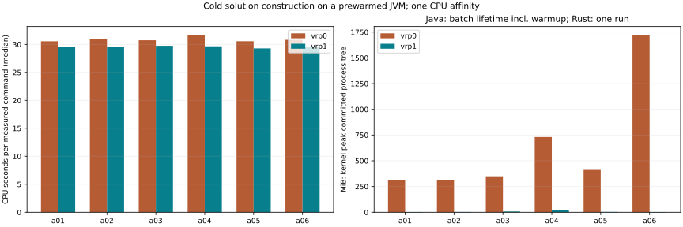

# First reproducible multi-scenario evaluation

Run created: 2026-11-15T19:01:14Z. Expected records: 180; observed: 180; missing: 0.

Evidence audit: `True`; 150 timed attempts; maximum observed search overrun 45.694 ms. Failures and unsupported records remain in the totals.

Search-objective gate: 80 sampled checks covering 64 distinct assignment/order mappings, plus 12 full-problem initial plans. Legacy scoring, the native oracle and the independent validator agree exactly. This is a gate for the restricted common profile, not an exhaustive proof of all legacy semantics.

## Versions and conditions

vrp-1 base `eb6333f90e898d47f24424d304a5ced7dec5a12d` plus the recorded evaluation instrumentation; adapter SHA-256 `51cf2b2bb769a58c5a2ca8e3623e632384bd735268544810eb1141830192183f`. Measured source archive SHA-256 `ecfdb672fe0af45282d776e55e893c9e7709d63cd0fad6d431a142fab411151f`. To run a new evaluation under the same method, use the current checkout and the [reproduction commands](../../evaluation.md#复现命令) with the pinned legacy dependencies.

vrp-0 `8cc39f6be1a1134c2749589b6e9a5abb2c5b50f0`; OptaPlanner `999-20240618-SNAPSHOT`, JDK 21. The complete evaluated domain and solver classes were rebuilt with javac; all dependency JAR hashes are pinned, including the SNAPSHOT artifacts.

1 solver thread(s), 30 seconds per solve, 5 independent seeds; main runs serial. Each Java group receives 3 × 20-second warmups. Java CPU excludes startup/warmup; Rust CPU covers its whole short-lived adapter process and native result explanation. Both final solutions are independently rescored outside these command intervals. Memory is committed process-tree high-water from Windows Job Objects: the Java lifetime includes warmup and preceding seeds; per-command sampled RSS is also retained. These scopes differ and do not establish end-to-end deployed-service resource ratios. See [method](../../evaluation.md).

## Common objectives: paired final quality

Only full assignment with zero hard violations is eligible for cost ratios. Business W/T/L compares independently evaluated common-profile objectives on all valid initialized outputs; cost W/T/L uses full feasible pairs. All pairs use identical seeds. Positive percentages mean lower vrp-1 travel cost. Failures remain explicit.

| Scenario | Start | Business W/T/L | Cost W/T/L | Noncomparable cost | Median cost change |
|---|---|---:|---:|---:|---:|
| a01-basic-50 | cold | 5/0/0 | 5/0/0 | 0 | +14.95% |
| a01-basic-50 | continue | 5/0/0 | 5/0/0 | 0 | +8.08% |
| a02-dense-200 | cold | 5/0/0 | 5/0/0 | 0 | +31.82% |
| a02-dense-200 | continue | 5/0/0 | 5/0/0 | 0 | +26.51% |
| a03-regional-480 | cold | 5/0/0 | 5/0/0 | 0 | +7.14% |
| a03-regional-480 | continue | 5/0/0 | 5/0/0 | 0 | +9.72% |
| a04-growth-1000 | cold | 5/0/0 | 5/0/0 | 0 | +31.93% |
| a04-growth-1000 | continue | 5/0/0 | 5/0/0 | 0 | +17.96% |
| a05-skills-levels-200 | cold | 5/0/0 | 5/0/0 | 0 | +2.82% |
| a05-skills-levels-200 | continue | 5/0/0 | 5/0/0 | 0 | +5.03% |
| a06-tight-wait-capacity-50 | cold | 5/0/0 | 5/0/0 | 0 | +6.54% |
| a06-tight-wait-capacity-50 | continue | 5/0/0 | 5/0/0 | 0 | +11.50% |

## Per-instance distributions and resources

Each cell reports median [min, max]. Time to first full feasible is right-censored when the standard is not met. Full JSON retains each value, quartiles, statuses and all excluded comparisons.

| Scenario / start | Engine | Full / runs | Travel seconds (full only) | First full ms | CPU s | Peak commit MiB |
|---|---|---:|---:|---:|---:|---:|
| a01-basic-50 / cold | vrp0 | 5/5 | 6420.0 [5940.0, 6900.0] | 69.0 [48.0, 163.0] | 30.5 [30.1, 31.4] | 310.5 [309.8, 315.2] |
| a01-basic-50 / cold | vrp1 | 5/5 | 5460.0 [5400.0, 5460.0] | 0.7 [0.6, 0.9] | 29.5 [29.2, 29.6] | 2.0 [2.0, 2.1] |
| a01-basic-50 / continue | vrp0 | 5/5 | 5940.0 [5580.0, 6600.0] | 25.2 [11.1, 35.3] | 30.4 [28.3, 30.6] | 315.3 [311.6, 315.3] |
| a01-basic-50 / continue | vrp1 | 5/5 | 5460.0 [5400.0, 5580.0] | 0.0 [0.0, 0.0] | 29.2 [28.5, 29.7] | 2.0 [2.0, 2.1] |
| a02-dense-200 / cold | vrp0 | 5/5 | 5280.0 [4980.0, 5580.0] | 665.1 [525.0, 896.1] | 30.9 [30.3, 31.2] | 315.6 [315.5, 325.6] |
| a02-dense-200 / cold | vrp1 | 5/5 | 3540.0 [3540.0, 3600.0] | 11.1 [8.4, 13.3] | 29.5 [29.3, 29.7] | 2.9 [2.9, 3.0] |
| a02-dense-200 / continue | vrp0 | 5/5 | 4980.0 [4620.0, 5100.0] | 23.2 [11.5, 67.1] | 30.8 [30.4, 31.1] | 317.6 [315.5, 323.9] |
| a02-dense-200 / continue | vrp1 | 5/5 | 3660.0 [3540.0, 3660.0] | 0.0 [0.0, 0.0] | 29.7 [27.1, 29.8] | 2.9 [2.9, 3.0] |
| a03-regional-480 / cold | vrp0 | 5/5 | 54600.0 [53640.0, 55560.0] | 2654.1 [2492.1, 3158.1] | 30.7 [30.6, 31.0] | 349.5 [346.6, 352.9] |
| a03-regional-480 / cold | vrp1 | 5/5 | 50700.0 [50640.0, 51360.0] | 35.6 [29.1, 42.1] | 29.8 [29.6, 29.8] | 7.3 [7.2, 7.3] |
| a03-regional-480 / continue | vrp0 | 5/5 | 54780.0 [53700.0, 55020.0] | 46.7 [14.6, 76.9] | 30.2 [30.2, 31.5] | 388.8 [381.5, 388.8] |
| a03-regional-480 / continue | vrp1 | 5/5 | 48840.0 [48480.0, 49620.0] | 0.0 [0.0, 0.1] | 29.7 [29.7, 29.8] | 7.3 [7.3, 7.3] |
| a04-growth-1000 / cold | vrp0 | 5/5 | 543060.0 [531480.0, 543600.0] | 11491.1 [9558.2, 12227.2] | 31.6 [30.9, 32.4] | 730.6 [702.2, 730.6] |
| a04-growth-1000 / cold | vrp1 | 5/5 | 362700.0 [350280.0, 401100.0] | 240.5 [236.5, 405.7] | 29.7 [29.6, 29.8] | 22.6 [22.6, 22.7] |
| a04-growth-1000 / continue | vrp0 | 5/5 | 425340.0 [410880.0, 426000.0] | 37.8 [21.5, 64.5] | 31.3 [31.0, 31.8] | 680.4 [679.5, 687.6] |
| a04-growth-1000 / continue | vrp1 | 5/5 | 346080.0 [339480.0, 352500.0] | 0.1 [0.1, 0.1] | 29.7 [29.5, 29.7] | 22.6 [22.6, 22.6] |
| a05-skills-levels-200 / cold | vrp0 | 5/5 | 21120.0 [20820.0, 21300.0] | 543.1 [397.0, 695.0] | 30.6 [30.3, 30.9] | 411.7 [349.5, 413.9] |
| a05-skills-levels-200 / cold | vrp1 | 5/5 | 20580.0 [19560.0, 20760.0] | 7.3 [6.7, 11.9] | 29.3 [28.1, 29.8] | 3.1 [3.0, 3.1] |
| a05-skills-levels-200 / continue | vrp0 | 5/5 | 21180.0 [21120.0, 21480.0] | 36.7 [19.7, 218.3] | 30.2 [29.4, 30.8] | 387.2 [352.8, 387.2] |
| a05-skills-levels-200 / continue | vrp1 | 5/5 | 20280.0 [19800.0, 20400.0] | 0.0 [0.0, 0.0] | 29.8 [29.5, 29.8] | 3.1 [3.0, 3.1] |
| a06-tight-wait-capacity-50 / cold | vrp0 | 5/5 | 6540.0 [6420.0, 6720.0] | 57.0 [52.0, 196.0] | 30.8 [30.5, 31.2] | 1718.5 [1690.0, 1724.3] |
| a06-tight-wait-capacity-50 / cold | vrp1 | 5/5 | 6000.0 [5940.0, 6360.0] | 0.8 [0.8, 1.2] | 29.5 [29.0, 29.7] | 2.1 [2.0, 2.1] |
| a06-tight-wait-capacity-50 / continue | vrp0 | 5/5 | 6780.0 [6480.0, 7740.0] | 23.1 [10.1, 63.1] | 30.7 [30.6, 31.8] | 1719.4 [1690.0, 1719.4] |
| a06-tight-wait-capacity-50 / continue | vrp1 | 5/5 | 6060.0 [5940.0, 6120.0] | 0.0 [0.0, 0.0] | 29.6 [29.4, 29.8] | 2.0 [2.0, 2.1] |

## JVM cold startup and warmup

Startup is process launch to adapter entry. Cold model compilation is the first warmup factory build, separate from search. JIT columns are compiler milliseconds in each warmup round. These are not additional measured quality samples.

The fixed warmup is part of this configuration. Compilation remains visible in the last warmup round; these measurements do not demonstrate convergence to a fully compiled steady state. A longer-warmup sensitivity study remains necessary before making that stronger claim.

| Scenario / start | JVM startup ms | Cold model compile ms | Warmup wall s | JIT ms by round |
|---|---:|---:|---:|---|
| a02-dense-200 / continue | 1001.22900390625 | 5748.6754 | 70.72 | [7899, 2860, 1337] |
| a02-dense-200 / cold | 1085.33740234375 | 6629.34 | 72.37 | [8457, 3004, 2329] |
| a04-growth-1000 / cold | 1487.796875 | 5900.0917 | 74.31 | [9073, 3942, 1180] |
| a06-tight-wait-capacity-50 / cold | 894.8388671875 | 4611.1746 | 69.30 | [5140, 2520, 1301] |
| a04-growth-1000 / continue | 1089.398681640625 | 5747.2197 | 74.13 | [8756, 3702, 1559] |
| a03-regional-480 / cold | 1039.60302734375 | 5168.237 | 71.78 | [8109, 3835, 1080] |
| a01-basic-50 / continue | 1466.709228515625 | 5943.3123 | 70.96 | [6874, 2655, 987] |
| a03-regional-480 / continue | 1021.97900390625 | 5561.6374 | 71.83 | [8169, 3216, 1509] |
| a06-tight-wait-capacity-50 / continue | 1181.907470703125 | 5600.5419 | 70.79 | [6917, 3209, 1251] |
| a05-skills-levels-200 / cold | 1259.62451171875 | 5307.2893 | 70.83 | [7079, 3515, 1758] |
| a05-skills-levels-200 / continue | 1276.052001953125 | 5621.5067 | 72.09 | [9398, 3616, 1615] |
| a01-basic-50 / cold | 841.96630859375 | 4707.7306 | 69.26 | [5130, 2400, 1298] |

## Migration and capability acceptance

These are synthetic frozen execution projections and semantic fixtures. They do not claim replay of real operational events. Old-version unsupported records are retained and excluded from algorithm rankings. Full service is required except preregistered blocked cargo after a fault and the known infeasible boundary case.

| Scenario | Passed / runs | Median unassigned | First standard ms | CPU s | Peak commit MiB | Statuses |
|---|---:|---:|---:|---:|---:|---|
| b01-pickup-two-dimensions-200 | 5/5 | 0 | 9.1 [7.0, 9.7] | 29.8 [27.9, 29.9] | 3.0 [2.9, 3.0] | {'succeeded': 5} |
| b02-precedence-50 | 5/5 | 0 | 5.0 [4.1, 13.9] | 29.8 [28.2, 29.8] | 2.0 [2.0, 2.1] | {'succeeded': 5} |
| b03-execution-insert-200 | 5/5 | 0 | 0.6 [0.5, 0.6] | 29.8 [29.0, 29.9] | 3.0 [3.0, 3.1] | {'succeeded': 5} |
| b04-execution-cancel-50 | 5/5 | 0 | 0.0 [0.0, 0.0] | 29.8 [29.7, 29.9] | 2.0 [2.0, 2.1] | {'succeeded': 5} |
| b05-fault-completed-lock-50 | 5/5 | 9 | 0.0 [0.0, 0.0] | 29.6 [27.2, 29.9] | 2.1 [2.0, 2.1] | {'succeeded': 5} |
| b06-insufficient-unreachable-50 | 5/5 | 46 | — | 29.8 [29.7, 29.8] | 2.0 [2.0, 2.1] | {'succeeded': 5} |

## Quality versus time

The curves use actual incumbent events. No curve is fabricated before an observed incumbent; gaps remain missing. Shading is the min–max seed range. Travel curves appear only when every measured seed has full assignment and zero hard violations; no free-travel unassigned solution enters the cost curve. The dotted line marks the requested budget; observed overruns are retained.

## Equal quality and limitations

The JSON `comparisons[].equal_quality` records the first actual time each implementation reaches the worse of the two paired final fully feasible travel costs. This is an explicitly post hoc target, separate from the preregistered first full-service standard; missing hits are censored. No unobserved time is extrapolated.

| Scenario / start | Paired target travel s | vrp-0 first ms | vrp-1 first ms |
|---|---:|---:|---:|
| a01-basic-50 / cold | 6420.0 [5940.0, 6900.0] | 964.0 [182.0, 10440.1] | 5.9 [2.3, 9.5] |
| a01-basic-50 / continue | 5940.0 [5580.0, 6600.0] | 13912.1 [1071.1, 18957.2] | 14.9 [7.0, 2107.0] |
| a02-dense-200 / cold | 5280.0 [4980.0, 5580.0] | 29402.0 [27938.1, 29591.0] | 118.2 [75.0, 171.8] |
| a02-dense-200 / continue | 4980.0 [4620.0, 5100.0] | 28416.2 [26961.2, 29662.1] | 122.1 [111.8, 285.3] |
| a03-regional-480 / cold | 54600.0 [53640.0, 55560.0] | 29806.1 [28669.1, 29890.1] | 1009.3 [478.5, 1566.5] |
| a03-regional-480 / continue | 54780.0 [53700.0, 55020.0] | 29552.7 [28419.4, 29828.9] | 207.4 [182.4, 253.2] |
| a04-growth-1000 / cold | 543060.0 [531480.0, 543600.0] | 29989.2 [29848.1, 30000.0] | 560.1 [509.8, 969.4] |
| a04-growth-1000 / continue | 425340.0 [410880.0, 426000.0] | 29969.5 [29661.4, 29985.6] | 189.6 [169.8, 334.8] |
| a05-skills-levels-200 / cold | 21120.0 [20820.0, 21300.0] | 28007.0 [25205.0, 29454.0] | 711.4 [158.5, 2524.3] |
| a05-skills-levels-200 / continue | 21180.0 [21120.0, 21480.0] | 29171.7 [28307.3, 29994.7] | 133.4 [72.7, 235.5] |
| a06-tight-wait-capacity-50 / cold | 6540.0 [6420.0, 6720.0] | 1500.0 [448.0, 2380.0] | 23.3 [9.6, 112.5] |
| a06-tight-wait-capacity-50 / continue | 6780.0 [6480.0, 7740.0] | 1169.1 [297.2, 4031.1] | 8.2 [4.5, 12.8] |

A stricter, also post hoc target is the better of each paired final costs. The following counts show how many seeds reached it within the observed run; missing times are censored, not extrapolated.

| Scenario / start | Stricter target travel s | vrp-0 hits / pairs | vrp-1 hits / pairs |
|---|---:|---:|---:|
| a01-basic-50 / cold | 5460.0 [5400.0, 5460.0] | 0/5 | 5/5 |
| a01-basic-50 / continue | 5460.0 [5400.0, 5580.0] | 0/5 | 5/5 |
| a02-dense-200 / cold | 3540.0 [3540.0, 3600.0] | 0/5 | 5/5 |
| a02-dense-200 / continue | 3660.0 [3540.0, 3660.0] | 0/5 | 5/5 |
| a03-regional-480 / cold | 50700.0 [50640.0, 51360.0] | 0/5 | 5/5 |
| a03-regional-480 / continue | 48840.0 [48480.0, 49620.0] | 0/5 | 5/5 |
| a04-growth-1000 / cold | 362700.0 [350280.0, 401100.0] | 0/5 | 5/5 |
| a04-growth-1000 / continue | 346080.0 [339480.0, 352500.0] | 0/5 | 5/5 |
| a05-skills-levels-200 / cold | 20580.0 [19560.0, 20760.0] | 0/5 | 5/5 |
| a05-skills-levels-200 / continue | 20280.0 [19800.0, 20400.0] | 0/5 | 5/5 |
| a06-tight-wait-capacity-50 / cold | 6000.0 [5940.0, 6360.0] | 0/5 | 5/5 |
| a06-tight-wait-capacity-50 / continue | 6060.0 [5940.0, 6120.0] | 0/5 | 5/5 |

Statuses: `{'succeeded': 150, 'unsupported': 30}`. See [all public distributions](summary.json). Private raw outputs, resource samples, source snapshots, commands and diagnostics remain in `corpus/evaluation/`. Historical v1 scores and old UI screenshots are not this round's timed results. The synthetic suite does not establish production performance, historical-data quality, global optimality, or a result about the OptaPlanner framework in general.
