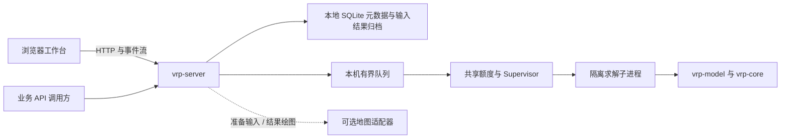

# vrp-1 独立部署与前端方案

状态：方案始于 2026-10-30；2026-10-31 已实现独立任务服务、执行中的实时重排与内嵌 `web/` 工作台，运行见 [server.md](server.md)。工作台以资源甘特为主，地图与对象详情联动；页面与业务操作约定见 [workbench.md](workbench.md)。输入/结果及执行历史存入 SQLite BLOB。工作台已接入开放底图与外部道路折线。

首版覆盖出发前规划与**执行中的实时重排**。继续优化仍叫继续优化，场景变化后重新计算仍叫重新求解。[实时重排说明](realtime-planning.md)记录已实现的执行状态、实际载荷、锁、触发、采用及具体边界。默认人工确认，支持配置自动采用；行驶中允许建议改道，正在服务与显式承诺锁受保护。

## 产品边界

vrp-1 应同时能作为库集成、命令行批处理工具和独立 Web 应用。独立应用需要自己的场景、任务、记录和操作界面；“纯计算、无 I/O”约束适用于核心和模型层，不应限制整个产品。

参考 vrp-0 的独立部署方式和场景编辑、任务历史、分数曲线、甘特图、地图复盘这些使用流程。vrp-0 的 REST、控制台共享运行状态，其前端已有可嵌入组件。vrp-1 可以延续交互和组件边界，但按新的 `.proto` 重建数据层，不能直接沿用旧单例场景状态、JSON 字段或评分含义。[vrp-0 README](https://github.com/Scisaga/vrp-0/blob/main/README.md)、[前端说明](https://github.com/Scisaga/vrp-0/blob/main/docs/interfaces/frontend.md)、[Compose](https://github.com/Scisaga/vrp-0/blob/main/docker-compose.yml)

| 层 | 责任 | 状态 |
|---|---|---|
| `vrp-core` / `vrp-model` | 编译请求、评分、搜索、解释；无网络或持久化 | 已有 |
| `vrp-worker` | 本机共享额度、隔离子进程、进度、取消、资源回收 | 已有 |
| `vrp-server` | 场景版本、任务队列、执行事件、重排、采用与记录 | 已有 |
| `web/` | 场景与参数编辑、任务、路线、实时回报、采用及回放 | 已有，随二进制发布 |
| 应用层地图展示 | 内嵌 MapLibre、OSM/自有底图、外部道路折线接收；原生矩阵导入 | 已实现 |

## 推荐结构

已新增 `crates/vrp-server`，用 Rust + Axum/Tokio 承担 HTTP 和事件流；复用现有同步 Supervisor，使用数量受限的执行线程调用它，不在异步请求处理线程中阻塞求解，也不为每个排队请求创建阻塞线程。Axum 本身基于 Tokio/Hyper，可复用 Tower 的中间件。[Axum 文档](https://docs.rs/axum/latest/axum/)

首版采用原生 ES module、HTML 和 CSS；`include_str!` 将工作台打入 Rust 服务，无前端依赖安装、CDN 或独立开发服务器。API 使用 `.proto` 定义的 ProtoJSON，uint64 版本号保留为字符串；不在浏览器复制评分算法。后续界面复杂度需要组件框架时可替换渲染层。

发行目标是一个容器镜像和 Windows/Linux 发行包。容器包含服务、求解程序与构建好的界面，挂载一个数据卷；小规模使用单服务 Compose。可用子命令启动同一二进制的 Worker 模式，也可随包附带现有求解程序。发行包必须同时验证可执行文件位置、资源限制和优雅退出，不依赖开发环境路径。

## 场景、任务与契约

支持多个场景，每次保存产生版本。任务引用不可变的场景版本和完整 SolveRequest；修改场景不会改变正在运行或已归档任务的输入。页面草稿与服务端保存版本分开，求解前提交明确的快照。请求、结果与引擎版本一起归档，避免多个用户或浏览器标签页争用“唯一当前场景”。

实时重排独立维护执行状态版本和生效计划版本，任务结果只是候选，不能用“最新完成任务”代表当前执行计划。任务提交和重排均可独立指定 `options`，参数变化不产生新的业务问题版本。

所有外部数据契约仍以 `proto/` 为唯一来源。已新增 `proto/vrp/app/v1/app.proto`，定义场景、任务、错误、进度事件和服务方法；HTTP 路径/方法绑定也随协议定义维护。Rust 类型及 ProtoJSON 映射已由协议生成；下一阶段前端的 TypeScript 类型也应由协议生成，不手写另一套权威 DTO。

浏览器使用该协议的 ProtoJSON，批量集成可传 protobuf 二进制。特别处理 int64 的字符串表示、bytes 的 base64 和字段缺省语义；不能把全部整数直接转成 JavaScript Number。大型矩阵不放入任务列表或事件推送，服务端归档原始请求字节用于回放，而不是假定 protobuf 重编码会产生相同 hash。[ProtoJSON 规则](https://protobuf.dev/programming-guides/json/)

以下能力已落实到 `app.proto`；路径与限制见 [server.md](server.md)：

| 能力 | 建议行为 |
|---|---|
| 场景创建、读取、保存 | 显式版本号；并发编辑冲突时提示，不覆盖他人版本 |
| 提交求解 | 返回任务 ID 与排队状态；幂等键绑定请求内容摘要 |
| 任务列表、详情 | 列表分页返回摘要，详情按需加载结果 |
| 进度事件流 | SSE 推送阶段、分数、耗时和评估量；序号支持重连/去重 |
| 取消任务 | 幂等；排队项直接取消，运行项向 Supervisor 发协作取消 |
| 结果与请求下载 | 返回明确任务版本的归档内容 |
| 重算与比较 | 建新任务，显式带上一版方案作为热启动；保留原任务 |
| 执行状态与实时重排 | 幂等接收执行事件，从当前位置、剩余工作与实际货物构造请求，合并触发重排 |
| 生效计划 | 默认人工确认，可配置自动采用；采用前按最新状态校验，过期候选不直接覆盖 |
| 健康与容量 | 就绪状态、可用额度、队列长度和资源配置 |

服务端第一版以 SQLite 同时记录任务、场景元数据及完整输入/结果 BLOB。WAL 适合这类单机服务，但同一库不跨主机或网络文件系统共享；单一服务进程持有本机调度权。[SQLite WAL](https://sqlite.org/wal.html)

提交成功之前先持久化输入，结果和终态在同一数据库操作中原子提交。后续若改成独立归档文件，需增加临时文件与原子提交协议。启动时扫描运行状态：尚未执行的持久化排队项可恢复；原来运行中的任务标记为 `interrupted`，明确没有恢复搜索进度，需要另建重试。事件缓冲只保留最新状态，重连直接返回最新快照。

## 资源与运行状态

沿用默认 30 秒总时限、120 秒总时限、DEEP 连续 300 秒无全局改善三个档位。页面显示实际生效的停止条件、排队时间、编译阶段、搜索耗时和距上次全局改善的时间；DEEP 不展示虚假的 300 秒总倒计时。现有进度只有最佳分数和统计，没有实时最佳路线，首版地图/甘特展示最终结果，不能暗示正在同步实时路线。

调度采用有界队列，队列中只保留任务元数据和归档引用，避免海量请求的矩阵长驻内存。启动前取得 `floor(CPU × multiplier)` 中该任务所需的全部线程额度；默认倍数 1，沿用 FIFO，单任务超过总额度直接拒绝。HTTP 请求体、上传并发、待处理字节、队列长度和事件订阅也要设上限。

必须另有宿主内存准入：每个子进程的内存限制并不限制父进程的请求/结果副本，CPU 倍数 1.8 也不意味着内存预算增加。调度上限同时取决于线程额度、配置的运行进程数和内存预算。容量不足时明确排队或返回容量错误，不能反复启动必然 OOM 的任务。解码与编译前后分别检查大小和结构，不只检查 protobuf 帧长度。

服务停止时先拒绝新任务，保存排队状态，向运行任务发出取消，接收已确认的最佳结果；宽限后强制回收并记录原因。现有 CLI 尚未接入控制台信号到协作取消，服务实施必须补上该行为。正常完成、带结果的主动取消、被强杀且没有最终结果、进程崩溃应有不同状态。

独立部署默认本机访问；对外暴露时提供单实例访问令牌或接入反向代理认证，同源会话用于浏览器事件流。生产配置、数据目录和含客户信息的报告不提交，开发测试语料继续放 `corpus/`。

## 前端工作台

| 区域 | 首版重点 |
|---|---|
| 场景 | 工单、车辆/工程师、网点、容量、技能、时间窗、固定工单、关联/依赖；校验定位到对应行 |
| 求解 | 30/120/DEEP 档位与线程数；高级区设置策略、深度、seed；单位和有效值明确 |
| 任务 | 状态、队列与运行耗时、停止、失败原因、分数曲线、历史版本 |
| 结果 | 路线表、甘特图、地图、未派原因、约束罚分明细、输入与结果导出 |
| 对比 | 两次任务的未派数、硬约束、车辆数、行驶时间、改派数；先比较 hard/medium 再比较 soft |
| 实时运营 | 实际与预计时间、执行状态、锁定承诺、实际载荷、插单/取消/故障、重排与采用确认 |
| 运行设置 | 本机线程总额、CPU 倍数、每任务内存、队列和保留策略、地图配置 |

全局入口为场景、求解任务、服务设置；场景内为数据与规则、规划方案、执行调度、历史记录。切换场景保留各自草稿、选中对象、任务和时间缩放。草稿仅在当前页面会话中保留，可保存或导出；关闭/重载页面前提示未保存内容。侧栏搜索应用于已加载场景，可继续分页加载。

“固定工单”在 v2 里固定的是原 agent，不固定访问顺序。业务数据表每页 30 行，支持表单维护工单、资源、地点、时间窗、技能、关联/前置及权重；资质与复杂矩阵等高级字段保留原生输入入口。甘特按资源或工单筛选，时间缩放、候选叠加与地图联动；服务端返回时刻，浏览器不复制评分算法。人工改派/改序通过独立评估端点产生候选。

任务与历史分页加载，完整结果在浏览器全局最多缓存 6 份；未变化的场景矩阵不重复下载。分数曲线仅记录本次页面实际观测的进度点，不伪造之前的轨迹；完整历史进度归档与表格虚拟化仍是后续增强。

执行中的视图区分已完成前缀、当前行程/服务和待执行后缀；显示生效方案、候选差异、过期提示和指令确认状态。跨业务/执行版本不能直接按总分判断改善，需在同一最新状态下重新评价候选与基准。

## 地图与矩阵

允许上传完整矩阵；历史迁移工具保留已有值并自动用现有 fallback 补齐缺失边、固化来源，因此无图商密钥也能运行与验证。地图有外部道路折线时显示道路路径，其余显示访问顺序虚线。

地图已内嵌 MapLibre，默认离线底图优先，缺包时以在线 OSM 底图过渡，支持自有瓦片/样式及 PMTiles。离线包准备、精度与导入见 [离线底图](offline-basemaps.md)；底图配置、外部折线协议、历史坐标转换和测试要求见 [开放地图与历史场景](maps-and-import.md)。

独立应用提供全 Rust Geofabrik 路网包准备、矩阵与路径计算，以及通用任务中心，见 [路网与通用任务](geo-tasks.md)。所有地图 I/O 位于应用和隔离路网进程；求解前完成矩阵物化及就绪校验。历史导入按已确认的默认来源处理坐标并留痕；新增原生场景和展示折线使用 WGS84。应用契约由 `.proto` 定义，不给引擎添加隐式转换规则。

图商服务端密钥留在服务端；浏览器地图 SDK 若要求公开 Key，应使用独立且受来源限制的浏览器 Key。地图准备时间独立于求解档位。

## 实施顺序与验收

1. **独立运行闭环**：新增应用协议与 `vrp-server`；完成提交、队列、状态、SSE、取消、结果下载、SQLite 恢复、信号处理。用已有 Supervisor 执行，覆盖并发准入、断连重连、重启和子进程故障。
2. **实时重排模型与服务**：先定义执行事实、生效方案、实际载荷、承诺锁和累计评分，再实现剩余问题编译、事件合并、过期检查、人工/自动采用与恢复。首版必须完成 [动态验收清单](realtime-planning.md#7-首版验收清单与实施顺序)。
3. **首版工作台与发行包**：场景导入/编辑、任务、路线表、甘特和示意地图，以及出发后的状态回报、插单/取消/故障、差异与采用流程；打包静态资源、容器及数据卷。验收从新环境打开浏览器到出发、执行事件、重排、采用和回放的全过程。
4. **业务地图**。使用 MapLibre 展示可配置底图与道路折线。路网、矩阵与路线准备见[路网与通用任务](geo-tasks.md)。

第 1、2 项及第 3 项的工作台已实现并测试；MapLibre 底图和外部路径展示已实现。上表包含后续增强项：高级字段全部表单化、完整进度曲线归档、自动归档清理和运行配置在线修改尚未提供。服务设置显示现有计算额度，部署配置仍在启动时指定。历史案例整理见 [corpus.md](corpus.md)；静态请求/结果不能作为动态能力已验收的证据。算法质量与吞吐应继续以同预算基准比较。
